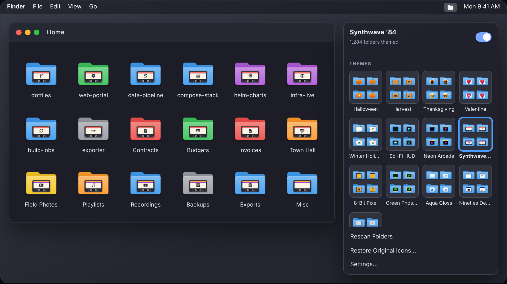

<p align="center"></p>
<h1 align="center">HyperIcon</h1>
<p align="center"><b>Finder folders that show what's inside.</b><br>
A macOS menu bar utility that gives every folder an icon based on its contents,<br>and lets you switch the whole icon theme in one click.</p>

<p align="center">
<a href="https://github.com/denmanjohn-maker/hypericon/releases/latest/download/HyperIcon.dmg"><b>Download for macOS</b></a> ·
<a href="https://denmanjohn-maker.github.io/hypericon/">Website</a> ·
<a href="docs/THEMES.md">Make a theme</a> ·
<a href="docs/RELEASING.md">Releasing</a>
</p>


<sub>Images in this README are illustrations rendered from the real theme icons.</sub>

## What it does

- **Content-aware icons.** A folder with a `.git` directory gets a Git icon, a Node project gets a Node icon, a folder that is mostly PDFs gets a PDF icon. You never assign icons by hand.
- **One-click themes.** Thirteen themes ship with the app, each covering all 27 folder types. A theme redraws the folder itself (a carved pumpkin, a wrapped gift, a cassette tape); the symbol on it still shows what is inside.
- **Stays current.** HyperIcon watches your home folder and updates an icon within seconds of its contents changing.
- **Fully reversible.** Every change is journaled before it is made. One click puts every folder back.
- **Out of the way.** It lives in the menu bar and has no Dock icon.

Requires macOS 14 or later. Runs on Apple silicon and Intel.

## Themes

| Theme | The folder becomes | Symbols are |
| --- | --- | --- |
| Winter Holiday | A wrapped gift with ribbon and bow | Printed on a gift tag |
| Halloween | A jack-o'-lantern with stem and vine | Carved and lit from inside |
| Thanksgiving | A turkey's feather fan with a pilgrim hat band | Set in the buckle |
| Valentine | A love-letter envelope with a wax heart | Stamped on the paper |
| Harvest | A wooden crate with a rope handle | Branded into the wood |
| Sci-Fi HUD | A riveted, hinged console panel | A holographic display |
| Synthwave '84 | A cassette tape | Printed on the label |
| Neon Arcade | An arcade cabinet with joystick and buttons | Neon on the screen |
| Green Phosphor CRT | A beige terminal | Glowing phosphor |
| 8-Bit Pixel | Chunky pixel art | Pixels |
| Platinum Classic | A bevelled late-90s folder | Flat ink |
| Nineties Desktop | A manila folder with hard shadows | Flat ink |
| Aqua Gloss | A glossy pinstriped folder | Raised gel |

| | |
| --- | --- |
|  |  |
|  |  |

All artwork is original and generated by [`tools/icongen`](tools/icongen). The OS-inspired themes are in the style of their era and contain no Apple or Microsoft artwork. Project icons are generic symbols rather than vendor logos.

## Install

1. Download [HyperIcon.dmg](https://github.com/denmanjohn-maker/hypericon/releases/latest/download/HyperIcon.dmg).
2. Open it and drag HyperIcon to Applications.
3. Launch HyperIcon, click its menu bar icon and pick a theme. Nothing on your Mac changes until you do.
4. macOS will ask for permission to look inside Desktop, Documents and Downloads. Allow the ones you want themed.

To update, download the latest DMG from [Releases](https://github.com/denmanjohn-maker/hypericon/releases) and replace the app in Applications. Your theme and settings are kept.

## How a folder gets its icon

1. **Marker files, first match wins.** In order: Xcode project or `Package.swift`, `Cargo.toml`, `go.mod`, `.sln`/`.csproj`, `pom.xml`/`build.gradle`, `pyproject.toml`/`requirements.txt`, `package.json`, `Chart.yaml`/`kustomization.yaml`, `*.tf`, `Dockerfile`/compose files, `Jenkinsfile`/`azure-pipelines.yml`/`.gitlab-ci.yml`, then `.git`.
2. **Majority by file type.** If at least half of the files are of one kind (documents, spreadsheets, presentations, PDFs, images, music, video, source code, archives, fonts, books, design files, data, web), the folder gets that icon. A folder that only holds subfolders is judged by what those subfolders contain.
3. **Otherwise** it gets the theme's plain folder.

Documents, Pictures, Music and Movies in your home folder always get their matching icon. Turn on **Always use the Git icon for repositories** in Settings if you prefer `.git` to win over language markers.

To change the rules, save a `rules.json` in `~/Library/Application Support/HyperIcon/`. Its format is the `RuleSet` type in [`Rules.swift`](Core/Sources/HyperIconCore/Rules.swift).

### Which folders are touched

- Folders inside your home folder, four levels deep by default (configurable from 1 to 8).
- Never: `~/Library`, `~/Applications`, hidden folders, app bundles and other packages, `node_modules`, `build`, `dist`, `target`, `vendor`, `Pods`, `DerivedData`, `venv`, or anything you exclude in Settings.
- A Git repository gets one icon on its top folder. Nothing inside a repository is changed.
- Folders you gave a custom icon yourself are left alone unless you turn on **Replace icons I set myself**.

### Git repositories stay clean

Finder stores a custom icon in a hidden file named `Icon` inside the folder. So that it never shows up in `git status`, HyperIcon adds it to that repository's local `.git/info/exclude` (never to a tracked `.gitignore`). The line is removed when you restore.

## Restoring your original icons

Any one of these puts everything back:

- **Menu bar:** HyperIcon → **Restore Original Icons…**
- **Terminal:**

  ```bash
  /Applications/HyperIcon.app/Contents/MacOS/HyperIcon restore --deep
  ```

- **App already deleted:** download `restore-icons.sh` from the [latest release](https://github.com/denmanjohn-maker/hypericon/releases/latest) and run:

  ```bash
  bash restore-icons.sh
  ```

Restoring removes every icon HyperIcon applied, puts back custom icons it replaced, removes its marker attribute and the Git exclude lines, and turns theming off. To uninstall, restore, quit, then move HyperIcon to the Trash. Its data lives in `~/Library/Application Support/HyperIcon` and can be deleted afterwards.

How it stays safe: an entry is written to `journal.jsonl` *before* each icon is changed, and every themed folder carries a `com.hypericon.applied` extended attribute, so restore works even if the journal is lost.

## Command line

The app binary doubles as a command line tool:

```bash
/Applications/HyperIcon.app/Contents/MacOS/HyperIcon themes
```

| Command | What it does |
| --- | --- |
| `themes` | List available themes |
| `apply <theme-id>` | Apply a theme to the home folder |
| `status` | Show the active theme and themed folder count |
| `classify <path>` | Show which icon a folder would get |
| `restore [--deep]` | Put original icons back |

## Building from source

You need Xcode 16 or later and [XcodeGen](https://github.com/yonaskolb/XcodeGen).

```bash
brew install xcodegen
```

```bash
xcodegen generate
```

```bash
open HyperIcon.xcodeproj
```

Run the core tests without Xcode:

```bash
swift test --package-path Core
```

| Path | Contents |
| --- | --- |
| `Core/` | Swift package: classifier, scanner, watcher, journal, restore, command line. Unit tested. |
| `App/` | SwiftUI menu bar app |
| `Themes/` | Bundled themes (generated PNGs and manifests) |
| `tools/icongen/` | Icon generator. `python3 tools/icongen/gen.py` rebuilds every theme (needs Pillow, Node and Playwright). |
| `tools/site/`, `site/` | Website assets and the GitHub Pages site |
| `scripts/` | DMG builder and the standalone restore script |
| `.github/workflows/` | CI, release and website deployment |

## Releasing

Pushing a tag such as `v0.1.0` builds, signs, notarizes and publishes a DMG. The one-time setup of signing secrets is in [docs/RELEASING.md](docs/RELEASING.md).

## License

MIT. See [LICENSE](LICENSE).
