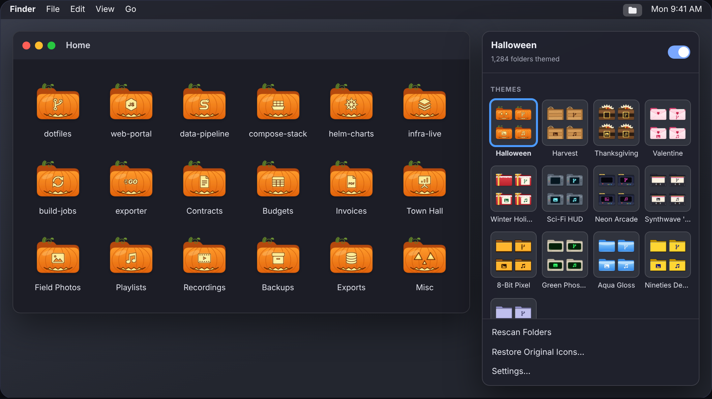
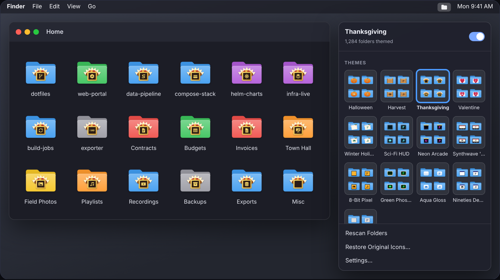
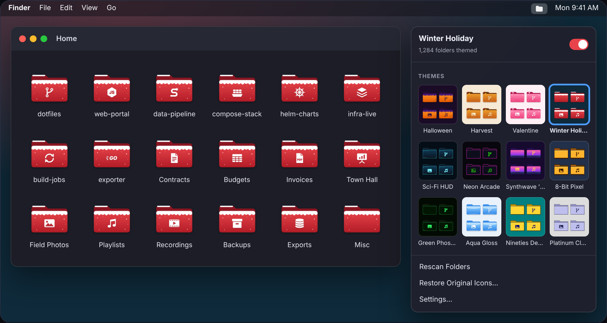

<p align="center"></p>
<h1 align="center">HyperIcon</h1>
<p align="center"><b>Finder folders that show what's inside.</b><br>
A macOS menu bar utility that gives every folder an icon based on its contents,<br>and lets you switch the whole icon theme in one click.</p>

<p align="center">
<a href="https://github.com/denmanjohn-maker/hypericon/releases/latest/download/HyperIcon.dmg"><b>Download for macOS</b></a> ·
<a href="https://denmanjohn-maker.github.io/hypericon/">Website</a> ·
<a href="docs/THEMES.md">Make a theme</a> ·
<a href="docs/RELEASING.md">Releasing</a>
</p>



<sub>Images in this README are illustrations rendered from the real theme icons.</sub>

## What it does

- **Content-aware icons.** A folder with a `.git` directory gets a Git icon, a Node project gets a Node icon, a folder that is mostly PDFs gets a PDF icon. You never assign icons by hand.
- **One-click themes.** Thirteen themes ship with the app, each covering all 27 folder types. A theme adds artwork to the folder (a carved pumpkin, a gift tag, a cassette tape) whose symbol shows what is inside.
- **Disks, Home and favorites too.** Each theme draws its own artwork for your disks, your home folder and the Finder favorites: Halloween turns Macintosh HD into a bubbling cauldron and a USB stick into a coffin, while Winter Holiday gives you a snow globe and a wrapped present.
- **Your colours.** Themes never set the folder colour. Each folder is drawn in the colour of its Finder tag, and its icon follows when you change the tag.
- **Stays current.** HyperIcon watches your home folder and updates an icon within seconds of its contents changing.
- **Fully reversible.** Every change is journaled before it is made. One click puts every folder back.
- **Out of the way.** It lives in the menu bar and has no Dock icon.

Requires macOS 14 or later. Runs on Apple silicon and Intel.

## Themes

| Theme | The artwork on each folder |
| --- | --- |
| Winter Holiday | A gift tag with a sprig of holly; the symbol is printed on the tag |
| Halloween | A jack-o'-lantern with the symbol carved and candle-lit |
| Thanksgiving | A turkey's feather fan behind a pilgrim buckle holding the symbol |
| Valentine | A love letter sealed with a wax heart; the symbol is pressed into the wax |
| Harvest | A wooden crate with the symbol branded in, and a sheaf of wheat |
| Sci-Fi HUD | A riveted console screen with a holographic symbol |
| Synthwave '84 | A cassette tape with the symbol on its striped label |
| Neon Arcade | An arcade cabinet with the symbol in neon on the screen |
| Green Phosphor CRT | A beige terminal with the symbol glowing on a green screen |
| 8-Bit Pixel | A chunky pixel-art badge |
| Platinum Classic | A bevelled grey plate in late-90s desktop style |
| Nineties Desktop | A little window with a title bar and a hard shadow |
| Aqua Gloss | A glossy pinstriped gel badge |

| | |
| --- | --- |
|  |  |
|  |  |

All artwork is original and generated by [`tools/icongen`](tools/icongen). The OS-inspired themes are in the style of their era and contain no Apple or Microsoft artwork. Project icons are generic symbols rather than vendor logos.

## Disks, Home and favorites

Besides folders, every theme has standalone artwork, not drawn on a folder, for these places:

| Place | Halloween | Winter Holiday | Synthwave '84 | Aqua Gloss |
| --- | --- | --- | --- | --- |
| Macintosh HD | Bubbling cauldron | Snow globe | Chrome boombox | Glossy drive |
| External and USB drives | Coffin | Wrapped present | VHS tape | Gel thumb drive |
| Network shares | Crystal ball | Sleigh | Radio tower at sunset | Glass globe |
| Home folder | Haunted house | Gingerbread house | Beach villa | Glass house |
| Desktop, Documents, Downloads, Applications, Pictures, Music, Movies | Lit tombstones | Glass baubles | Neon signs | Gel orbs |

Each one is a setting under **Settings → Disks & favorites**:

| Setting | Default | Notes |
| --- | --- | --- |
| Theme favorite folders | On | Desktop, Documents, Downloads, Pictures, Music, Movies and `/Applications`. Folders inside them still get content icons. `/Applications` is only changed if your account is an administrator. |
| Theme my home folder | On | |
| Theme external and USB drives | On | Applied when a drive is connected. A drive that is unplugged when you restore is put back the next time you connect it. Read-only disks and Time Machine disks are skipped. |
| Theme network shares | Off | The icon is saved on the server, so other people who use the share may see it. |
| Theme Macintosh HD | Off | Asks for your administrator password once, the first time it sets the startup disk's icon. Changing themes after that doesn't ask again; restoring the original icon may ask once more. A cancelled prompt isn't repeated until you pick another theme or turn the setting back on. |

Some things macOS does not allow an app to change:

- **The Finder sidebar** always draws its own small symbols for Favorites and Locations. Your themed favorites show in Finder windows, the path bar, Get Info and the Dock.
- **The "Computer" icon** (Go → Computer) comes from a system file protected by System Integrity Protection. Macintosh HD and your home folder carry the theme instead.

## Install

1. Download [HyperIcon.dmg](https://github.com/denmanjohn-maker/hypericon/releases/latest/download/HyperIcon.dmg).
2. Open it and drag HyperIcon to Applications.
3. Launch HyperIcon, click its menu bar icon and pick a theme. Nothing on your Mac changes until you do.
4. macOS will ask for permission to look inside Desktop, Documents and Downloads. Allow the ones you want themed.

To update, download the latest DMG from [Releases](https://github.com/denmanjohn-maker/hypericon/releases) and replace the app in Applications. Your theme and settings are kept.

## How a folder gets its icon

1. **Marker files, first match wins.** In order: Xcode project or `Package.swift`, `Cargo.toml`, `go.mod`, `.sln`/`.csproj`, `pom.xml`/`build.gradle`, `pyproject.toml`/`requirements.txt`, `package.json`, `Chart.yaml`/`kustomization.yaml`, `*.tf`, `Dockerfile`/compose files, `Jenkinsfile`/`azure-pipelines.yml`/`.gitlab-ci.yml`, then `.git`.
2. **Majority by file type.** If at least half of the files are of one kind (documents, spreadsheets, presentations, PDFs, images, music, video, source code, archives, fonts, books, design files, data, web), the folder gets that icon. A folder that only holds subfolders is judged by what those subfolders contain.
3. **Otherwise** it gets the theme's plain folder.

Documents, Pictures, Music and Movies in your home folder always get their matching icon. Turn on **Always use the Git icon for repositories** in Settings if you prefer `.git` to win over language markers.

To change the rules, save a `rules.json` in `~/Library/Application Support/HyperIcon/`. Its format is the `RuleSet` type in [`Rules.swift`](Core/Sources/HyperIconCore/Rules.swift).

### Folder colour

The folder under the artwork is drawn in the colour of the folder's Finder tag. To change it, right-click the folder in Finder and pick a tag colour, or add a tag in **Get Info**. HyperIcon notices within a few seconds and redraws the icon. Folders without a coloured tag are blue.

- If a folder has several coloured tags, Finder decides which colour counts, and HyperIcon uses that one.
- Turn off **Use each folder's tag colour** in Settings to make every folder blue.
- The custom colour from macOS 26's **Customize Folder** is not read; only tag colours are. Finder ignores that colour anyway once a folder has a custom icon.
- Restoring original icons leaves your tags exactly as they are.

### Which folders are touched

- Folders inside your home folder, four levels deep by default (configurable from 1 to 8).
- Your home folder itself, `/Applications` and connected disks, depending on the settings above. Nothing inside `/Applications` or at the top of a disk other than its icon is changed.
- Never: `~/Library`, `~/Applications`, hidden folders, app bundles and other packages, `node_modules`, `build`, `dist`, `target`, `vendor`, `Pods`, `DerivedData`, `venv`, or anything you exclude in Settings.
- A Git repository gets one icon on its top folder. Nothing inside a repository is changed.
- Folders you gave a custom icon yourself are left alone unless you turn on **Replace icons I set myself**.

### Git repositories stay clean

Finder stores a custom icon in a hidden file named `Icon` inside the folder. So that it never shows up in `git status`, HyperIcon adds it to that repository's local `.git/info/exclude` (never to a tracked `.gitignore`). The line is removed when you restore.

## Restoring your original icons

Any one of these puts everything back:

- **Menu bar:** HyperIcon → **Restore Original Icons…**
- **Terminal:**

  ```bash
  /Applications/HyperIcon.app/Contents/MacOS/HyperIcon restore --deep
  ```

- **App already deleted:** download `restore-icons.sh` from the [latest release](https://github.com/denmanjohn-maker/hypericon/releases/latest) and run:

  ```bash
  bash restore-icons.sh
  ```

Restoring removes every icon HyperIcon applied (folders, favorites, your home folder and disks), puts back custom icons it replaced, removes its marker attribute and the Git exclude lines, and turns theming off. To uninstall, restore, quit, then move HyperIcon to the Trash. Its data lives in `~/Library/Application Support/HyperIcon` and can be deleted afterwards.

How it stays safe: an entry is written to `journal.jsonl` *before* each icon is changed, and every themed folder carries a `com.hypericon.applied` extended attribute, so restore works even if the journal is lost.

## Command line

The app binary doubles as a command line tool:

```bash
/Applications/HyperIcon.app/Contents/MacOS/HyperIcon themes
```

| Command | What it does |
| --- | --- |
| `themes` | List available themes |
| `apply <theme-id>` | Apply a theme to the home folder |
| `status` | Show the active theme and themed folder count |
| `classify <path>` | Show which icon a folder would get |
| `restore [--deep]` | Put original icons back |

## Building from source

You need Xcode 16 or later and [XcodeGen](https://github.com/yonaskolb/XcodeGen).

```bash
brew install xcodegen
```

```bash
xcodegen generate
```

```bash
open HyperIcon.xcodeproj
```

Run the core tests without Xcode:

```bash
swift test --package-path Core
```

| Path | Contents |
| --- | --- |
| `Core/` | Swift package: classifier, scanner, watcher, journal, restore, command line. Unit tested. |
| `App/` | SwiftUI menu bar app |
| `Themes/` | Bundled themes (generated PNGs and manifests) |
| `tools/icongen/` | Icon generator. `python3 tools/icongen/gen.py` rebuilds every theme (needs Pillow, Node and Playwright). |
| `tools/site/`, `site/` | Website assets and the GitHub Pages site |
| `scripts/` | DMG builder and the standalone restore script |
| `.github/workflows/` | CI, release and website deployment |

## Releasing

Pushing a tag such as `v0.1.0` builds, signs, notarizes and publishes a DMG. The one-time setup of signing secrets is in [docs/RELEASING.md](docs/RELEASING.md).

## License

MIT. See [LICENSE](LICENSE).
